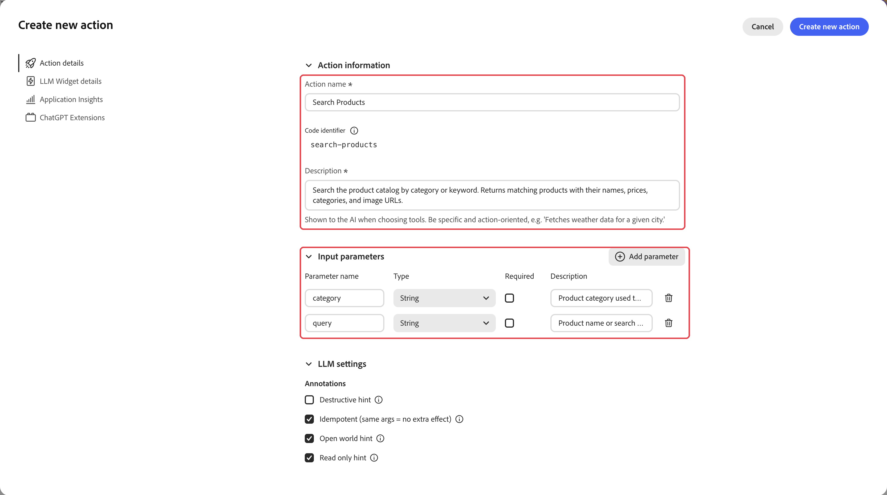

# Erstellen einer neuen Aktion {#create-action-from-scratch}

>[!IMPORTANT]
>
>LLM-Apps stehen allen AEM Sites Cloud Service-Kunden zur Entwicklung und Verwaltung eigener Apps zur Verfügung. Sobald die Erfassung beginnt, wird jeder App-Aufruf für die AEM Sites-Inhaltsanfragen des Kunden angerechnet. Adobe gibt die Pipettierungsrate und das Startdatum vor dem Inkrafttreten der Pipettierung an.

>[!NOTE]
>
>In diesem Handbuch wird von einer grundlegenden Vertrautheit mit Adobe Edge Delivery Services (EDS) ausgegangen. Wenn Sie neu bei EDS sind, lesen Sie zunächst das [EDS-Entwickler-Tutorial](https://www.aem.live/developer/tutorial) und [Erkunden von Blöcken](https://www.aem.live/docs/exploring-blocks) um die Grundlagen - Blöcke, die `decorate` und die EDS-Projektstruktur - zu lernen, bevor Sie ein Widget verbinden.

Fügen Sie eine Funktion hinzu, die von der Plattform nicht erstellt wurde. Definieren Sie die Aktion in [!DNL LLM Apps], schreiben Sie den Handler in das verknüpfte Repository und fügen Sie bei Bedarf ein Widget hinzu.

**In diesem Handbuch** Erfahren Sie, wie Sie eine Aktion definieren, ihren Handler implementieren und ein optionales Widget verbinden. Testen Sie die Aktion lokal, stellen Sie die App bereit und versuchen Sie die Aktion in einer unterstützten LLM-Plattform.

Beginnen Sie bei Ihrer ersten Mobile App mit [Einrichten der Infrastruktur](/help/guides/create-app.md) und [Erstellen von Aktionen](/help/guides/creating-actions.md). Im Handbuch Aktionen erstellen werden die automatische Erstellung auf einer Website und die manuelle Erstellung erläutert.

## Voraussetzungen

Sie benötigen:

- Eine vorhandene LLM-App.
- Ein verknüpftes Handler-Repository.
- Ein lokaler Klon des Repositorys mit installierten Abhängigkeiten.
- Ein EDS-Projekt, wenn die Aktion ein Widget anzeigt.
- Eine klare API oder Datenquelle für Produktionsergebnisse.

## Planen der Aktion

Entwerfen Sie jede Aktion für eine klare Benutzeraufgabe. Bevor Sie die Benutzeroberfläche öffnen, definieren Sie Folgendes:

- **Intent** - Was der Benutzer zu erreichen versucht.
- **Beschreibung** - wann die Aktion ausgewählt werden soll.
- **Eingaben** - die vom Benutzer mindestens benötigten Informationen.
- **Result** - der Text und die strukturierten Daten, die vom Handler zurückgegeben werden.
- **Verhalten** - ob die Aktion Daten liest, Daten ändert oder externe Systeme aufruft.
- **Widget** — ob das Ergebnis eine visuelle Schnittstelle benötigt.

Verwenden Sie diesen Plan beispielsweise für eine Aktion **Produkte suchen**:

```text
Intent: Find products matching a category or search phrase
Inputs:
  category: optional string
  query: optional string
Result:
  content: text summary
  structuredContent: products and total count
Behavior: read-only, idempotent, open-world
Widget: product cards
```

Verwandte, aber unterschiedliche Aufgaben getrennt halten. Verwenden Sie separate Aktionen für die Produktsuche und den Produktkauf, da die Aufgaben unterschiedliche Eingaben, Risiken und Bestätigungsanforderungen aufweisen.

## Erstellen der Aktionsmetadaten

Öffnen Sie die App und wählen Sie **[!UICONTROL Aktionen]** und dann **[!UICONTROL Aktion erstellen]** aus.

Das **[!UICONTROL Neue Aktion erstellen]** Dialogfeld enthält vier Registerkarten: **[!UICONTROL Aktionsdetails]**, **[!UICONTROL LLM-Widget-]**, **[!UICONTROL Anwendungseinblicke]** und **[!UICONTROL ChatGPT-Erweiterungen]**. Das Dialogfeld wird geöffnet unter **[!UICONTROL Aktionsdetails]**. Der Editor für gespeicherte Aktionen verwendet dieselben Registerkarten.

Mit den optionalen **[!UICONTROL ChatGPT-Erweiterungen]** können Benutzer die App direkt öffnen, einen benutzerdefinierten Datei-Viewer verwenden oder Ressourcen im Composer auf unterstützten Clients suchen. Konfigurieren Sie diese, wenn die entsprechende Aktion und das entsprechende Widget-Verhalten bereit sind. Siehe [Konfigurieren von ChatGPT-Erweiterungen](/help/guides/chatgpt-extensions.md).

### Geben Sie die Aktionsinformationen und Eingabeparameter ein



Geben **[!UICONTROL unter &quot;]**&quot; Folgendes ein:

- **[!UICONTROL Aktionsname]** - Ein kurzer Aufgabenname, z. B *„Produkte*.
- **[!UICONTROL Beschreibung]** — Erklären Sie, wann die Aktion verwendet wird und was sie zurückgibt.

Das Dialogfeld leitet eine **[!UICONTROL Code-Kennung]** vom Namen ab, z. B. `search-products`. Die Kennung wird nach der Erstellung korrigiert und muss in der App eindeutig sein. Verwenden Sie die genaue Kennung für den Handler-Ordner.

Eine nützliche Beschreibung ist spezifisch:

```text
Search the product catalog by category or keyword. Returns matching
products with their names, prices, categories, and image URLs.
```

Vermeiden Sie vage Beschreibungen wie *Abrufen von Produktinformationen*. Die LLM-Plattform verwendet die Beschreibung zur Auswahl zwischen Aktionen.

Wählen **[!UICONTROL unter „Eingabeparameter]** die Option **[!UICONTROL Parameter hinzufügen]** einmal für jeden Wert aus, den der Handler akzeptiert. Geben Sie für jeden Parameter Folgendes ein:

- **[!UICONTROL Parametername]** - der Schlüssel, den der Handler erhält.
- **[!UICONTROL type]** - Zeichenfolge, Zahl, Ganzzahl, Boolesch, Objekt oder Datei.
- **[!UICONTROL Erforderlich]** - Angabe, ob für die Aktion der Wert erforderlich ist.
- **[!UICONTROL Beschreibung]** - wie der Wert extrahiert wird.

Für **Produkte suchen**:

```text
category
  Type: String
  Required: No
  Description: Product category used to narrow the catalog.

query
  Type: String
  Required: No
  Description: Product name or search phrase.
```

Verwenden Sie stabile Parameternamen. Zum Ändern eines Namens müssen auch der Handler und seine Tests geändert werden.

### Konfigurieren der LLM-Einstellungen

Erweitern Sie **[!UICONTROL LLM-Einstellungen]**. Der Abschnitt ist standardmäßig reduziert.


Wählen **[!UICONTROL unter]** nur die Hinweise aus, die für die Aktion zutreffen:

- **[!UICONTROL Destruktiver Hinweis]** - Die Aktion kann Daten löschen oder dauerhaft ändern.
- **[!UICONTROL Idempotent (gleiche Argumente = kein zusätzlicher Effekt)]** - Die Wiederholung derselben Anfrage hat die gleiche Wirkung.
- **[!UICONTROL Open World Hint]** - Die Aktion kommuniziert mit externen Systemen.
- **[!UICONTROL Schreibgeschützter Hinweis]** - Die Aktion ändert die Daten nicht.

Beispielsweise ist die Produktsuche normalerweise schreibgeschützt, idempotent und offen.

Geben **[!UICONTROL unter „OpenAI]** Metadaten“ kurze Meldungen ein, die während und nach Abschluss der Aktion angezeigt werden und jeweils bis zu 64 Zeichen lang sein können:

```text
Invoking status text: Searching products...
Invoked status text: Products found
```

Unter **[!UICONTROL Sichtbarkeit]**:

- **[!UICONTROL KI-Modell bereitstellen]** ermöglicht dem Modell die Auswahl der Aktion.
- **[!UICONTROL Als Widget in der Programmoberfläche anzeigen]** zeigt das konfigurierte Widget an.

Bei der Sichtbarkeit wird nicht der Widget-Typ ausgewählt. Für eine Aktion, die nur Text enthält, wählen Sie **[!UICONTROL Keine interaktive Benutzeroberfläche]** unter **[!UICONTROL LLM Widget-Details]** > **[!UICONTROL Widget-Typ]** aus.

### Konfigurieren von Anwendungseinblicken {#configure-analytics}

Öffnen Sie **[!UICONTROL Application Insights]**. **[!UICONTROL Benutzerabsicht erfassen]** ist standardmäßig ausgewählt: Die LLM-Plattform erstellt eine kurze, anonymisierte Zusammenfassung dessen, was der Benutzer beim Ausführen der Aktion versucht hat zu erreichen.

Wenn Sie Ihre eigene [!DNL Adobe Analytics] oder [!DNL Customer Journey Analytics] einrichten, wird auch die Benutzerabsicht an diese gesendet. Siehe [Einrichten von Adobe Analytics und Customer Journey Analytics](/help/guides/analytics-setup.md).

Lesen Sie die Anweisungen unter dem Kontrollkästchen, die die Zusammenfassung anleiten. Beschränken Sie sie auf einen nicht sensiblen, anonymisierten Zweck und beschreiben Sie Ihre Datenerfassung in Ihrer Datenschutzerklärung. Die Anweisungen können bis zu 2.000 Zeichen lang sein. Löschen Sie **[!UICONTROL Benutzerabsicht erfassen]**, um keine Zusammenfassung zu erfassen.


Vollständige Felddefinitionen finden Sie unter [Aktion und Widget-Felder](/help/reference/reference-docs.md).

## Konfigurieren des Widgets

Öffnen Sie **[!UICONTROL LLM-Widget-Details]**. Bei einer Aktion, die nur Text enthält, wählen Sie **[!UICONTROL Keine interaktive Benutzeroberfläche]** unter **[!UICONTROL Widget-Typ]** aus und überspringen Sie die verbleibenden Widget-Einstellungen.


Konfigurieren **[!UICONTROL unter „Widget]** Informationen:

- **[!UICONTROL Widget-Typ]** - Wählen Sie **[!UICONTROL Edge Delivery Services-Block]** für ein interaktives Widget aus.
- **[!UICONTROL Widget-Domain]** - der Sandbox-Ursprung des Widgets. Die Benutzeroberfläche identifiziert sie als erforderlich für die App-Übermittlung und eindeutig pro App. Sie ist nicht identisch mit der EDS-Seiten-URL.
- **[!UICONTROL Widget-Beschreibung]** - Was das Modell nach dem Rendern des Widgets sagt, bis zu 512 Zeichen.

Die Widget-Beschreibung unterscheidet sich von der Aktionsbeschreibung:

- **Aktionsbeschreibung** hilft dem Modell bei der Entscheidung, wann die Aktion aufgerufen werden soll.
- **Widget-Beschreibung** wird `_meta["openai/widgetDescription"]` zugeordnet und fasst zusammen, was die gerenderte Komponente anzeigt, wodurch der wiederholte Narrativ reduziert wird.

[!DNL LLM Apps] wendet die Widget-Beschreibung als Komponentenmetadaten an. Geben Sie die Beschreibung nicht vom Handler zurück.

Erweitern Sie **[!UICONTROL Vorlagen-URLs]** und geben Sie Folgendes ein:

- **[!UICONTROL Script URL]** - der Einstiegspunkt des EDS-Widgets.
- **[!UICONTROL Widget URL]** - die veröffentlichte EDS-Seite für diese Aktion.

Typische URLs sind:

```text
Script URL:
https://main--<repo>--<owner>.aem.live/scripts/aem-embed.js

Widget URL:
https://main--<repo>--<owner>.aem.live/<widget-page>
```

Fügen **[!UICONTROL unter „CSP-]**&quot; nur die Ursprünge hinzu, die das Widget für Assets und Netzwerkanfragen benötigt. Ein Widget, das externe Ressourcen lädt, wird möglicherweise nicht gerendert, wenn sein CSP unvollständig ist.


Wenn das EDS-Projekt oder die Widget-Seite noch nicht vorhanden ist, schließen Sie [Eigenes EDS-Projekt ](/help/guides/bring-your-own-eds.md)) ab und kehren Sie dann zur Aktion zurück.

## Speichern der Aktion

Wählen Sie **[!UICONTROL Neue Aktion erstellen]** aus. Die Aktion wird auf der Seite Aktionen mit dem Badge **Nicht bereitgestellt** angezeigt.

Beim Speichern werden die Metadaten erstellt, für die Aktion ist jedoch ein Handler erforderlich.

Beim erneuten Öffnen der gespeicherten Aktion zeigt der Editor dieselben Registerkarten an. Um spätere Änderungen zu speichern, wählen Sie **[!UICONTROL Änderungen speichern]**.

## Implementieren des Handlers

Klonen Sie das verknüpfte Handler-Repository und installieren Sie dessen Abhängigkeiten:

```bash
npm install
```

Erstellen:

```text
actions/
└── search-products/
    └── index.js
```

Der Ordnername muss mit der Code-Kennung der Aktion übereinstimmen, die im Aktionseditor angezeigt wird.

Die vollständige Beziehung zwischen Ergebnisvertrag und Handler-Widget finden Sie unter [Anpassen eines generierten Handlers](/help/guides/customize-handler.md).

### Händlervertrag

Exportieren Sie eine asynchrone Funktion:

```javascript
module.exports = async (args) => {
  return {
    content: [
      { type: 'text', text: 'Response for the LLM platform.' }
    ],
    structuredContent: {
      // Data for the widget.
    }
  };
};
```

Der Handler empfängt die in der Benutzeroberfläche definierten Parameter.

### `content`

Die LLM-Plattform liest `content` als Textfallback:

```javascript
content: [
  { type: 'text', text: 'Found 3 matching products.' }
]
```

Geben Sie immer nützliche `content` zurück, auch wenn die Aktion über ein Widget verfügt.

### `structuredContent`

Das Widget nutzt `structuredContent` als einfaches Objekt:

```javascript
structuredContent: {
  products: [
    { id: 'P-100', name: 'Product A', price: '$20' }
  ],
  total: 1
}
```

Die Form muss mit dem übereinstimmen, was der EDS-Block aus `bridge.toolResult` liest.

### Verbinden einer API

API-Aufrufe im Server-seitigen Handler behalten. In diesem Beispiel wird eine öffentliche Produkt-API aufgerufen. Konfigurieren Sie den HTTPS-Ursprung der API in einer [App-Variablen](/help/guides/app-variables.md) namens `PRODUCT_API_ORIGIN`. Das Beispiel akzeptiert die oben definierten `query`- und `category`, erfordert mindestens einen Parameter und erfordert keine Anmeldeinformationen.

```javascript
const { getVariable } = require('@adobe/llm-apps-runtime');

module.exports = async ({ query = '', category = '' } = {}, extra) => {
  const normalizedQuery = typeof query === 'string' ? query.trim() : '';
  const normalizedCategory = typeof category === 'string' ? category.trim() : '';
  if (typeof query !== 'string' || typeof category !== 'string'
      || (!normalizedQuery && !normalizedCategory)
      || normalizedQuery.length > 200 || normalizedCategory.length > 100) {
    return {
      isError: true,
      content: [{ type: 'text', text: 'Enter a valid product search.' }],
      structuredContent: { products: [], total: 0 }
    };
  }

  const apiOrigin = getVariable(extra, 'PRODUCT_API_ORIGIN');
  if (!apiOrigin) {
    throw new Error('Product API configuration is unavailable.');
  }

  const origin = new URL(apiOrigin);
  if (origin.protocol !== 'https:') {
    throw new Error('Product API configuration must use HTTPS.');
  }

  const url = new URL('/v1/products', origin);
  if (normalizedQuery) {
    url.searchParams.set('query', normalizedQuery);
  }
  if (normalizedCategory) {
    url.searchParams.set('category', normalizedCategory);
  }

  const response = await fetch(url, {
    signal: AbortSignal.timeout(8000)
  });

  if (!response.ok) {
    throw new Error('Product service request failed.');
  }

  const payload = await response.json();
  if (!payload || !Array.isArray(payload.products)
      || !payload.products.every((product) =>
        product
        && typeof product.id === 'string'
        && typeof product.name === 'string'
        && typeof product.price === 'string')) {
    throw new Error('Product service returned an unexpected response.');
  }

  const products = payload.products.map((product) => ({
    id: product.id,
    name: product.name,
    price: product.price
  }));

  return {
    content: [
      { type: 'text', text: `Found ${products.length} matching products.` }
    ],
    structuredContent: {
      products,
      total: products.length
    }
  };
};
```

Geben Sie keine API-Anmeldeinformationen in Quell-Code, Aktionsmetadaten, Widget-JavaScript, Protokolle oder benutzerseitige Fehler ein. Die Benutzeroberfläche **[!UICONTROL Variablen und Geheimnisse]** unterstützt derzeit nur nicht vertrauliche Variablen und keine geheimen Daten. Speichern Sie kein API-Token in einer Variablen. Wenn Ihre Upstream-API Anmeldeinformationen erfordert, vereinbaren Sie einen Mechanismus für genehmigte Server-seitige Anmeldeinformationen, bevor Sie sie verbinden.

Für Produktions-Code validieren Sie die vollständige Upstream-Antwort, bevor Sie genehmigte Felder `structuredContent` zuordnen.

## Hinzufügen von Handler-Tests

Erstellen Sie den passenden Test:

```text
test/
└── actions/
    └── search-products.test.js
```

Mindestens testen:

- Gültige Eingabe.
- Fehlende oder ungültige Eingabe.
- Leere Ergebnisse.
- API-Zeitüberschreitung oder -Fehler.
- Fehlerhafte API-Daten.
- Die vom Widget erwartete `structuredContent`.

Ausführen:

```bash
npm test
```

Informationen zum Projektlayout und zu lokalen MCP-Tests finden Sie unter [Lokale Handlerentwicklung und -tests](/help/reference/development.md).

## Lokales Testen der Aktion

Ausführen:

```bash
npm run dev:local
```

Ohne eine lokale `actions.json` erkennt der Server den Handler mit minimalen Metadaten und ohne Validierung des Eingabeschemas.

Verwenden Sie MCP Inspector oder `curl`, um:

1. Auflisten der registrierten Aktionen.
2. Rufen Sie die neue Aktion mit repräsentativen Argumenten auf.
3. Überprüfen Sie `content` und `structuredContent`.
4. Testen Sie ungültige und leere Anfragen.

## Verbinden und Testen des Widgets

Wenn die Aktion über ein Widget verfügt:

1. Veranlassen Sie das Widget, die `structuredContent` des Handlers zu lesen.
2. Rendern Sie externe Werte mit sicheren DOM-APIs wie `textContent`.
3. Fügen Sie den Status „Laden“, „Leer“ und „Fehler“ hinzu.
4. Zeigen Sie die EDS-Seite lokal in der Vorschau an.
5. Überprüfen Sie CSP-, CORS- und Widget-URLs.

Siehe [Eigenes EDS-Projekt ](/help/guides/bring-your-own-eds.md).

## Bereitstellen und Testen

1. Übertragen Sie die Änderungen an Handler und Widget und übertragen Sie sie.
2. [Bereitstellen der App](/help/guides/deploy-your-app.md) für das Staging.
3. Testen Sie die App in [ChatGPT](/help/guides/test-in-chatgpt.md) oder [Claude](/help/guides/test-in-claude.md).
4. Überprüfen Sie die Aktionsauswahl mit Eingabeaufforderungen, die mit der Aktion übereinstimmen, und mit nicht verwandten Eingabeaufforderungen, die nicht dazu aufrufen.
5. Nachdem die Staging-Umgebung erfolgreich ausgeführt wurde, stellen Sie sie in der Produktionsumgebung bereit.

Wenn Metadaten ohne übereinstimmenden Handler vorhanden sind, registriert die Bereitstellung die Aktion mit einem Standard-Stub. Fügen Sie den Handler hinzu, bevor Sie die Aktion den Benutzern zur Verfügung stellen.
