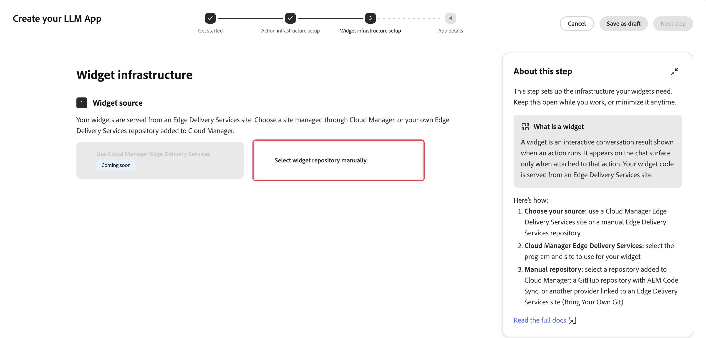
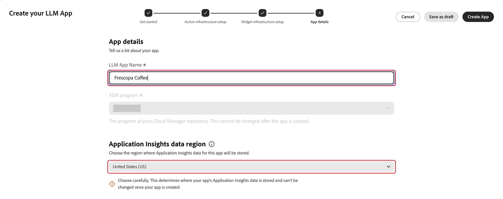

# Einrichten der Infrastruktur {#create-first-app}

>[!IMPORTANT]
>
>LLM-Apps stehen allen AEM Sites Cloud Service-Kunden zur Entwicklung und Verwaltung eigener Apps zur Verfügung. Sobald die Erfassung beginnt, wird jeder App-Aufruf für die AEM Sites-Inhaltsanfragen des Kunden angerechnet. Adobe gibt die Pipettierungsrate und das Startdatum vor dem Inkrafttreten der Pipettierung an.

Infrastruktur ist die technische Grundlage für Ihre App: die Repositorys, die den Code speichern, und die Services, die die Aktionshandler ausführen und die Widgets für die Benutzer bereitstellen.

Wie in der [Übersicht](/help/overview/overview.md#key-concepts) erläutert, führt ein **Aktionshandler** eine Aufgabe aus, z. B. das Suchen von Produkten, während ein **Widget** das Ergebnis als interaktives Erlebnis in der Konversation darstellt.

[!DNL LLM Apps] speichert Handler- und Widget-Quell-Code in zwei separaten Repositorys:

- **Aktions-Repository** - enthält die Server-seitigen Handler und ihre Tests.
- **Widget-Repository** - Enthält den Code und die Stile für die interaktiven Widgets.

Beispielsweise ruft ein Produkt-Such-Handler übereinstimmende Produkte ab und zeigt diese als Produktkarten an. Die Repositorys speichern diesen Code. Adobe I/O Runtime führt die bereitgestellten Handler aus, und Edge Delivery Services stellt die Widgets bereit.

Der Setup-Assistent bereitet diese Repositorys vor und verbindet die Services, die Ihre App benötigt. Eine von zwei Optionen auswählen:

- **[!DNL LLM Apps]verwaltete Infrastruktur** der schnellste Einstieg. Adobe erstellt und hostet die Repositorys für Ihre Aktionshandler und Widgets, sodass Sie keine Repositorys selbst einrichten müssen.
- **Ihre eigenen Repositorys** Bewahren Sie den Code Ihrer App in Repositorys auf, die Ihnen gehören und zu [!DNL Cloud Manager] hinzugefügt wurden. Sie können auf [!DNL GitHub], [!DNL GitHub Enterprise], [!DNL GitLab], [!DNL Bitbucket] oder [!DNL Azure DevOps] gehostet werden. Die Plattform initialisiert leere Repositorys mit den erforderlichen Projektdateien, sodass Sie keine Aktion oder Widget-Code vorbereiten müssen.

**In diesem Handbuch:** Erfahren Sie, wie Sie mit dem Einrichtungsassistenten eine Infrastrukturoption auswählen und Ihre App erstellen. Fahren Sie nach dem Setup mit [Aktionen erstellen](/help/guides/creating-actions.md) fort.

Beim Erstellen der App wird **nicht** Aktionserstellung gestartet. Starten Sie die Aktionserstellung getrennt von der App-Seite.

## Öffnen des Assistenten zum Erstellen einer App

Öffnen Sie [Adobe LLM Apps](https://experience.adobe.com/llm-apps). Wählen Sie auf der Startseite die Option **[!UICONTROL Erste Schritte]** aus. Wenn Sie bereits eine App geöffnet haben, verwenden Sie den App-Selektor und wählen Sie **[!UICONTROL Neue App erstellen]**.

Der **[!UICONTROL Create Your LLM App]**-Assistent beginnt mit **[!UICONTROL Erste Schritte]**. Wählen Sie aus, wie die technische Umgebung eingerichtet werden soll.

| Infrastrukturoption | Im Assistenten auswählen | Was es bedeutet |
|---|---|---|
| **[!DNL LLM Apps]verwaltete Infrastruktur** | **[!UICONTROL Übernehmen wir das]** | Adobe erstellt und verwaltet die Repositorys und verbundenen Services für Ihre App. Code-Zugriff ist auf Anfrage verfügbar. |
| **Ihre eigenen Repositorys** | **[!UICONTROL Mein Cloud Manager-Setup verwenden]** | Sie können zwei Repositorys auswählen, die [!DNL Cloud Manager] hinzugefügt werden sollen: eines für Aktions-Handler und eines für Widgets. Die Plattform initialisiert sie, wenn sie leer sind. |

Beide Optionen unterstützen eine spätere automatische Aktionserstellung. Für keine dieser Optionen müssen Aktionen manuell geschrieben werden.

## Verwenden [!DNL LLM Apps] verwalteten Infrastruktur {#adobe-managed-infrastructure}

Verwenden Sie diese Option, damit Adobe die Repositorys und Connected Services für Ihre App einrichten und verwalten kann. Sie müssen keine Repositorys erstellen oder [!DNL GitHub] Apps selbst installieren.

1. Wählen Sie **[!UICONTROL Übernehmen wir]** aus.
2. Wählen Sie **[!UICONTROL Nächster Schritt]** aus.
3. Vollständige [App-Details](#app-details).
4. Wählen Sie **[!UICONTROL App erstellen]** aus.

Auf der App-Seite wird **[!UICONTROL Einrichten der App]** angezeigt, während Adobe die Repositorys vorbereitet und die Widget-Site verbindet. Die Benutzeroberfläche zeigt an, dass die Einrichtung in der Regel 1-2 Minuten dauert. Aktionen, Tests und die Bereitstellung bleiben bis zur Einrichtung nicht verfügbar.

Wenn das Setup fehlschlägt, lesen Sie den Fehler und wählen Sie &quot;**[!UICONTROL &quot;]**. Wenn die Seite den Fortschritt nicht überprüfen kann, wird die Einrichtung im Hintergrund fortgesetzt. Wählen Sie **[!UICONTROL Erneut überprüfen]**, um die Verbindung wiederherzustellen.

Fahren Sie nach Abschluss des Setups mit [Aktionen erstellen](/help/guides/creating-actions.md) fort.

## Eigene Repositorys verwenden {#your-own-repositories}

Wählen **[!UICONTROL Mein Cloud Manager-Setup verwenden]** und dann **[!UICONTROL Nächster Schritt]**. Dieser Pfad weist vier Assistentenschritte auf:

**Erste Schritte → Einrichten der Aktionsinfrastruktur → Einrichten der Widget-Infrastruktur → App-Details.**

[!DNL LLM Apps] gelangt über [!DNL Cloud Manager] mit Ihrem Adobe-Konto zu Ihren Repositorys. Sie installieren keine [!DNL GitHub] App.

### Voraussetzungen {#own-repositories-prerequisites}

- Zugriff auf das [!DNL Cloud Manager] Programm, zu dem die App gehören wird.
- Zwei Repositorys, eines für Aktionshandler und eines für Widgets. Leere Repositorys sind in Ordnung, einschließlich eines Repositorys, das nur die README enthält, die von seinem Git-Host erstellt wurde.
- Beide Repositorys [zu Cloud Manager hinzugefügt](https://experienceleague.adobe.com/de/docs/experience-manager-cloud-manager/content/managing-code/external-repositories) als private Repositorys, mit validiertem Besitz und dem Status **Bereit**. [!DNL Cloud Manager] müssen in der Lage sein, ihnen zu schreiben. Ein schreibgeschütztes Zugriffstoken reicht nicht aus.

Es werden nur Repositorys aufgelistet, die Sie selbst hosten. Repositorys, die von Adobe in [!DNL Cloud Manager] gehostet werden, werden nicht unterstützt.

#### Ihr Widget-Repository ist eine Edge Delivery Services-Site {#widget-repository-is-an-eds-site}

Widgets werden von einer [!DNL Edge Delivery Services]-Site (EDS) bereitgestellt und Ihr Widget-Repository enthält den Code dieser Site. Stellen Sie sicher, dass das Widget-Repository zu einer EDS-Website gehört oder wird. Es gibt zwei Möglichkeiten, eine einzurichten:

- **Jeder Git-Anbieter mit Bring Your Own Git.** Erstellen Sie die EDS-Site in [!DNL Cloud Manager] und verknüpfen Sie sie mit **Bring Your Own Git** mit Ihrem Repository. [!DNL Cloud Manager] synchronisiert dann den Code des Repositorys mit der Site. Führen Sie diese Schritte aus, bevor Sie den Assistenten starten. Siehe [Eigenes Git mitbringen](https://www.aem.live/developer/byo-git).
- **Ein [!DNL GitHub]-Repository mit AEM Code Sync.** Richten Sie die EDS-Site selbst ein, wie im [Edge Delivery Services-Tutorial](https://www.aem.live/developer/tutorial). Der Assistent führt Sie durch die Installation von AEM Code Sync und die Überprüfung des Zugriffs, nachdem Sie das Repository validiert haben.

Der Widget-Schritt erkennt, welcher Fall zutrifft. Siehe [Einrichten der Widget-](#set-up-the-widget-infrastructure).

>[!TIP]
>
>Selbst wenn Ihr Unternehmen bereits über eine EDS-Website verfügt, erstellen Sie eine separate EDS-Website für Ihre [!DNL LLM Apps] Widgets.

>[!NOTE]
>
>Bei einem leeren Repository schreibt die Validierung die ersten Projektdateien. Wählen Sie die für diese Anwendung vorgesehenen Repositorys aus, bevor Sie **[!UICONTROL Repository validieren]** auswählen.

### Einrichten der Aktionsinfrastruktur

Das Aktions-Repository enthält die Server-seitigen Handler und Tests, die ausgeführt werden, wenn eine LLM-Plattform eine Aktion aufruft.

1. Wählen Sie unter **[!UICONTROL Cloud Manager]** Programm das Programm aus, das Ihr Aktions-Repository enthält.
2. Wählen Sie unter **[!UICONTROL Cloud Manager-]** das Aktions-Repository aus. Wenn er fehlt, fügen Sie ihn [!DNL Cloud Manager] mit **[!UICONTROL Zu Cloud Manager wechseln]** hinzu und aktualisieren Sie dann die Liste.
3. Wählen Sie **[!UICONTROL Repository validieren]** aus. Bei der Validierung wird ein leeres Repository mit dem Adobe LLM Apps-Textbaustein initialisiert. Ein vorhandenes Repository muss ein kompatibles Aktionsprojekt enthalten.
4. Wenn **[!UICONTROL Repository validiert]** angezeigt wird, wählen Sie **[!UICONTROL Nächster Schritt]** aus.

Die Plattform sendet den generierten Aktionscode an eine Verzweigung dieses Repositorys. Wenn Sie **[!UICONTROL Als geprüft markieren]** wird die Verzweigung zusammengeführt. Siehe [Erstellen von Aktionen](/help/guides/creating-actions.md).

### Einrichten der Widget-Infrastruktur {#set-up-the-widget-infrastructure}

Widgets sind optionale visuelle Antworten, die an Aktionen angehängt werden, z. B. Produktkarten oder Buchungsformulare. Edge Delivery Services (EDS) stellt sie von einer Site bereit, die Ihr Widget-Repository verwendet.

1. Wählen **[!UICONTROL unter]** Widget-Quelle **[!UICONTROL die Option Widget-Repository manuell]**.

   

2. Wählen Sie unter **[!UICONTROL Cloud Manager]** Programm das Programm aus, das das Widget-Repository enthält. Sie kann sich vom Programm des Aktions-Repositorys unterscheiden.
3. Wählen Sie unter **[!UICONTROL Edge Delivery Services-]** das Widget-Repository aus. Wählen Sie nicht das Aktions-Repository.
4. Wählen Sie **[!UICONTROL Repository validieren]** aus. Bei der Validierung wird ein leeres Repository mit dem AEM-Textbaustein initialisiert. Ein vorhandenes Repository muss ein kompatibles EDS-Projekt sein.

Was als Nächstes geschieht, hängt davon ab, wo das Widget-Repository gehostet wird.

#### Widget-Repository bei einem anderen Anbieter (eigenes Git mitbringen) {#widget-repository-byog}

Bei einem Repository auf [!DNL GitLab], [!DNL Bitbucket], [!DNL Azure DevOps] oder [!DNL GitHub Enterprise] findet die Validierung die EDS-Site, die Links zum Repository [!DNL Cloud Manager]. Der Assistent zeigt die Site unter **[!UICONTROL Edge Delivery Services-Site]** an.

[!DNL Cloud Manager] synchronisiert den Code des Repositorys mit dieser Site, sodass Sie keine AEM-Code-Synchronisierung benötigen. Wählen Sie **[!UICONTROL Nächster Schritt]** aus.

Wenn bei der Validierung gemeldet wird, dass keine Site verknüpft ist, verknüpfen Sie das Repository mit einer EDS-Site in [!DNL Cloud Manager] mit **Eigenes Git einbringen** und überprüfen Sie dann erneut. Siehe [Eigenes Git mitbringen](https://www.aem.live/developer/byo-git).

#### Widget-Repository auf GitHub {#widget-repository-github}

Ein [!DNL GitHub] Repository verwendet AEM Code Sync , um seinen Code zu veröffentlichen. Nach der Validierung zeigt der Assistent **[!UICONTROL Installieren von AEM Code Sync]** an. Verwenden Sie dasselbe Adobe-Konto für [!DNL LLM Apps]-, AEM-Site- und DA-Schreibzugriff.

##### Einrichten des Zugriffs auf die AEM-Site {#aem-site-access}

**Neuinstallation:** Wählen Sie **[!UICONTROL AEM Code Sync installieren]** und gewähren Sie ihr Zugriff auf das Widget-Repository. Führen Sie den Einrichtungsassistenten auf der Installationsbestätigungsseite aus, um sich selbst als Site-Administrator hinzuzufügen.

**Bestehende EDS-Site:** Lassen Sie die AEM Code Sync -Installation bestehen und vergewissern Sie sich, dass sie das ausgewählte Widget-Repository abdeckt. Bitten Sie einen bestehenden Site-Administrator, AEM-Benutzeradmin unter `https://tools.aem.live/tools/user-admin/index.html/?org=<org>&site=<site>` zu öffnen und Ihr Adobe-Konto mit der Rolle `admin` hinzuzufügen. Sie müssen die Codesynchronisierung nicht neu installieren.

Ersetzen Sie `<org>` und `<site>` durch Ihre Organisations- und Site-Namen in AEM. Ihr Site-Administrator kann diese Werte bestätigen.

##### Schreibzugriff für DAM gewähren {#da-write-access}

Bitten Sie sowohl für neue als auch vorhandene Sites einen Administrator der DAM-Organisation, Folgendes zu tun:

1. Öffnen Sie die DAM-Konfiguration unter `https://da.live/config#/<org>/` und ersetzen Sie `<org>` durch die DAM-Organisation, in der die Inhalte Ihrer Site gespeichert sind.
2. Öffnen Sie das **Berechtigungen**. Wenn es nicht vorhanden ist, wählen Sie **[!UICONTROL Tabelle hinzufügen]** benennen Sie es `permissions` und fügen Sie die Spaltenüberschriften **Pfad**, **Gruppen** und **Aktionen** hinzu. Sie können auch eine Spalte **Kommentare** hinzufügen, um jede Regel zu beschreiben.
3. Fügen Sie eine Zeile hinzu, die Ihrem Adobe-Konto Schreibzugriff auf alle Inhalte der Website gewährt: Verwenden Sie den Inhaltspfad der Website in **path**, Ihre E-Mail-Adresse des Adobe-Kontos in **groups** und `write` Sie in **actions**. Speichern Sie die Konfiguration.

   

   Der Screenshot verwendet fiktive Konten. Ersetzen Sie `widget-author@example.com` durch Ihre Adobe-Konto-E-Mail und verwenden Sie den Inhaltspfad Ihrer Site anstelle des organisationsweiten `/ + **`. Die `CONFIG` Zeile ist für Konfigurationsadministratoren. Sie müssen sie nicht ändern, um Inhaltszugriff zu gewähren.

AEM-Site-Rollen gewähren keinen Schreibzugriff auf die geräteübergreifende Analyse. Sie benötigen keinen organisationsweiten Schreibzugriff.

Weitere Informationen zum Konfigurieren von DA-Berechtigungen finden Sie unter [Berechtigungen und Sicherheit](https://www.aem.live/docs/ew/administering/permissions).

##### Überprüfen des AEM-Setups {#validate-aem-setup}

1. Kehren Sie zu [!DNL LLM Apps] zurück und wählen Sie **[!UICONTROL AEM-Setup validieren]**.
2. Wenn **[!UICONTROL AEM-Setup überprüft]** angezeigt wird, wählen Sie **[!UICONTROL Nächster Schritt]**.

Wenn die Validierung fehlschlägt, folgen Sie der Meldung, um den Zugriff auf die [AEM](#aem-site-access)Site oder den [DA-Schreibzugriff](#da-write-access) zu überprüfen, und wiederholen Sie die Validierung.

>[!NOTE]
>
>Der Assistent markiert **[!UICONTROL Cloud Manager Edge Delivery Services verwenden]** als **[!UICONTROL In Kürze verfügbar]** und lässt keine Auswahl zu. Verwenden Sie die Option „Manual widget-repository“.

## Mobile-App-Details eingeben {#app-details}

Beide Infrastrukturoptionen enden mit **[!UICONTROL App-Details]**.

1. Geben Sie den **[!UICONTROL LLM-App-Namen]** ein. Verwenden Sie einen Namen, der die Marke oder das Erlebnis identifiziert, z. B *„Frescopa Coffee*.
2. Wählen Sie das **[!UICONTROL AEM]** Programm aus, zu dem die App gehört. Wenn Sie nur Zugriff auf ein Programm haben, wählt der Assistent dieses Programm automatisch aus. Bei Ihren eigenen Repositorys ist das Programm das Programm des Aktions-Repositorys und kann hier nicht geändert werden.
3. Wählen **[!UICONTROL unter „Application Insights-]**&quot; **[!UICONTROL USA (USA)]** oder **[!UICONTROL Europa (EU)]**.
4. Wählen Sie **[!UICONTROL App erstellen]** aus.

>[!IMPORTANT]
>
>Die Datenregion AEM-Programm und Programm-Insights kann nach der Erstellung der App nicht mehr geändert werden. Die Region bestimmt, wo die Daten zu Application Insights der App gespeichert werden.

Wenn kein AEM-Programm verfügbar ist, bitten Sie Ihren Administrator um Zugriff. Wenn das Laden der Programme fehlschlägt, wählen Sie **[!UICONTROL Programme erneut laden]** aus.

Der Assistent öffnet die App-Seite nach der Erstellung. Warten Sie bei [!DNL LLM Apps] verwalteten Infrastruktur, bis die Einrichtung der Infrastruktur abgeschlossen ist, bevor Sie fortfahren.

Um die Repositorys später zu überprüfen, öffnen Sie die **[!UICONTROL Einstellungen]**. Im Abschnitt **[!UICONTROL Repository]** werden das Programm und der Name jedes Repositorys sowie für ein Widget-Repository, das Bring Your Own Git verwendet, dessen EDS-Site und Herkunft angezeigt. Repositorys können nach der Erstellung der App nicht mehr geändert werden.

Apps, die zuvor mit der Adobe LLM Apps [!DNL GitHub] App erstellt wurden, funktionieren weiterhin mit ihren vorhandenen Repositorys.

## Weiter: Erstellen der Aktionen

Ihre App verfügt jetzt über die Infrastruktur, es wurden jedoch noch keine Aktionen generiert. Fahren Sie mit [Aktionen erstellen](/help/guides/creating-actions.md) fort, um eine Website zu analysieren oder manuelle Aktionserstellung zu wählen.

Informationen zur Beziehung zwischen Aktionsmetadaten, Handlern, Widgets und dem bereitgestellten MCP-Server finden Sie [Wie eine App verkabelt wird](/help/guides/app-architecture.md).
