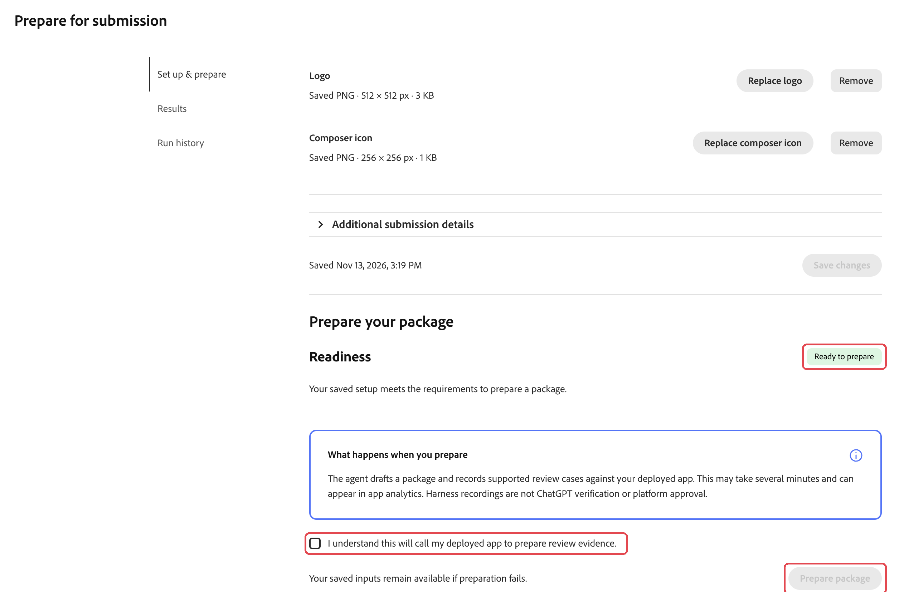

# Vorbereiten der App für die ChatGPT-Übermittlung {#prepare-submission}

>[!IMPORTANT]
>
>LLM-Apps stehen allen AEM Sites Cloud Service-Kunden zur Entwicklung und Verwaltung eigener Apps zur Verfügung. Sobald die Erfassung beginnt, wird jeder App-Aufruf für die AEM Sites-Inhaltsanfragen des Kunden angerechnet. Adobe gibt die Pipettierungsrate und das Startdatum vor dem Inkrafttreten der Pipettierung an.

Um Ihre App im [!DNL ChatGPT]-Plug-in-Verzeichnis aufzulisten, laden Sie ein Übermittlungspaket in OpenAI hoch. [!DNL LLM Apps] hilft Ihnen bei der Vorbereitung. Es erstellt das ZIP-Paket aus Ihrer App, sendet Testanfragen an Ihre bereitgestellte App und zeichnet die Ergebnisse auf, damit Sie sie überprüfen können. Anschließend laden Sie das Paket hoch und schließen die Übermittlung im OpenAI-Portal ab.

**In diesem Handbuch:** Erfahren Sie, wie Sie in [!DNL LLM Apps] ein Einreichungspaket für Ihre App vorbereiten und was Sie als Nächstes im OpenAI-Portal tun können.

>[!NOTE]
>
>[!DNL LLM Apps] sendet Ihre App nicht an OpenAI. Entwickler- und Domain-Verifizierung, Verbindungstests, Überprüfungen und Veröffentlichungen finden im OpenAI-Portal statt. Siehe [Hochladen und Senden Ihres Plug-ins](https://developers.openai.com/plugins/deploy/submission).

## Voraussetzungen

- [Bereitstellen der App](/help/guides/deploy-your-app.md) für **Produktion**. [!DNL LLM Apps] sendet seine Testanfragen an die Produktionsversion Ihrer App.
- Stellen Sie sicher, dass die Aktionen, die Sie veröffentlichen möchten, überprüft und aktiviert werden.
- Halten Sie Ihren Herausgebernamen bereit, und geben Sie die URLs Ihrer Support-Seite, die Datenschutzrichtlinie und die Nutzungsbedingungen an.
- Zwei Symbole stehen bereit: ein Logo und ein Composer-Symbol. Jedes muss ein quadratisches, nicht animiertes PNG sein, 64-4096 Pixel pro Seite und nicht größer als 1 MiB. Verwenden Sie nur Bilder, die zur Veröffentlichung berechtigt sind.
- Wenn Ihre App [Endbenutzer authentifiziert](/help/guides/authentication.md) registrieren Sie einen OAuth-Client für die [!DNL ChatGPT] bei Ihrem Identitätsanbieter, es sei denn, Ihr Identitätsanbieter unterstützt dynamische Client-Registrierung (DCR) oder Client-ID-Metadatendokumente (CIMD).

## Öffnen, zur Übermittlung vorbereiten

Nachdem Sie Ihre App zum ersten Mal für die Produktion bereitgestellt haben, zeigt die App-Seite die Karte **[!UICONTROL Vorbereiten der Übermittlung]** unter **[!UICONTROL App testen]**.

Wählen Sie **[!UICONTROL Einrichten]** aus. Später ändert sich die Schaltfläche auf der Karte und zeigt den nächsten Schritt an, z. B. **[!UICONTROL Fortschritt anzeigen]** oder **[!UICONTROL Ergebnisse anzeigen]**.

Der **[!UICONTROL „Vorbereiten der Übermittlung]** wird geöffnet. Es umfasst drei Abschnitte: **[!UICONTROL Einrichten und Vorbereiten]**, **[!UICONTROL Ergebnisse]** und **[!UICONTROL Ausführungsverlauf]**.

## Hinzufügen der Übermittlungsdetails

In **[!UICONTROL Einrichten und Vorbereiten]**:

1. Geben Sie **[!UICONTROL Publisher &amp; legal]** &quot;**[!UICONTROL Publisher name]**, **[!UICONTROL Support-]**, **[!UICONTROL Privacy Policy-URL]** und **[!UICONTROL Terms of Service-URL]**.
   - Geben **[!UICONTROL unter &quot;]**&quot; den öffentlichen Namen ein, den Sie als Herausgeber im OpenAI-Portal verifizieren werden.
   - Unter **[!UICONTROL Support-URL]** geben Sie die URL einer Support- oder Kontaktseite ein. Eine E-Mail-Adresse wird nicht akzeptiert.
   - Die Datenschutzrichtlinie muss die Daten beschreiben, die Ihre App, Authentifizierung, Widget und Analytics erfassen und verwenden.
2. Wählen **[!UICONTROL unter &quot;]**&quot; die Option **[!UICONTROL Logo auswählen]** und dann **[!UICONTROL Composer-Symbol auswählen]** und wählen Sie jeweils eine PNG-Datei aus.
3. Wenn Ihre App die Authentifizierung verwendet, öffnen Sie **[!UICONTROL OAuth-Client-Registrierung]** und wählen Sie aus, wie [!DNL ChatGPT] einen OAuth-Client erhält. Wählen Sie nur eine Option aus, die Ihr Identitätsanbieter unterstützt:
   - **[!UICONTROL Bereitgestellt]** - Sie haben einen Client für [!DNL ChatGPT] registriert. Geben Sie die **[!UICONTROL Registrierte Client-ID]** ein. Geben Sie nicht Ihre Adobe IMS-Client-ID ein.
   - **[!UICONTROL DCR]** - [!DNL ChatGPT] registriert einen Client mithilfe der dynamischen Client-Registrierung.
   - **[!UICONTROL CIMD]** - [!DNL ChatGPT] identifiziert sich mit einem Client-ID-Metadatendokument.

   [!DNL LLM Apps] fragt nie nach einem Client-Geheimnis.
4. Optional können Sie **[!UICONTROL Zusätzliche Übermittlungsdetails]** öffnen und den Auflistungstext, den Paketnamen und die Version, Kaufdetails, die URL der gehosteten Demo, die unterstützten Länder und die Versionshinweise eingeben. Wenn Sie ein Feld leer lassen, entwirft [!DNL LLM Apps] den Text nach Möglichkeit. Alles, was nicht entworfen werden kann, wird später unter **[!UICONTROL Vor dem Senden]** angezeigt.
5. Wählen **[!UICONTROL Änderungen speichern]**.

Die Vorbereitung verwendet nur die gespeicherten Details und Symbole.

>[!TIP]
>
>OpenAI-Reviewer benötigen ein Demovideo Ihrer App, das idealerweise in [!DNL ChatGPT] aufgezeichnet wird, unter einer URL, die sie öffnen können. Die Testaufzeichnung von [!DNL LLM Apps] ist für eigene Prüfungen gedacht und ersetzt diese Demo nicht. Zeichnen Sie die Demo auf, laden Sie sie an einen Speicherort hoch, auf den Reviewer zugreifen können, und geben Sie ihre URL in **[!UICONTROL gehostete Demo-URL]** ein, bevor Sie das Paket vorbereiten.

## Paket vorbereiten

Aktivieren **[!UICONTROL unter „Paket vorbereiten]** das Kontrollkästchen **[!UICONTROL Bereitschaft]**. **[!UICONTROL Bereit zur Vorbereitung]** bedeutet, dass Ihre gespeicherten Details den Anforderungen entsprechen. Andernfalls werden im Abschnitt fehlende Elemente aufgelistet, z. B. erforderliche Details oder eine erfolgreiche Produktionsbereitstellung.

1. Lesen Sie **[!UICONTROL Was passiert, wenn Sie vorbereiten]**. [!DNL LLM Apps] erstellt das Paket und sendet Testanfragen an die bereitgestellte App. Dies kann einige Minuten dauern, und die Testanfragen können in der Analyse Ihrer App angezeigt werden.
2. Wählen Sie die **[!UICONTROL Ich verstehe, dass dadurch meine bereitgestellte App aufgerufen wird, um Überprüfungsnachweise vorzubereiten.]** Kontrollkästchen.
3. Wählen Sie **[!UICONTROL Paket vorbereiten]** aus.

Während der Vorbereitung wird im Dialogfeld **[!UICONTROL Vorbereitung läuft]** angezeigt. [!DNL LLM Apps] verwendet Ihre App und Details so wie bei der Auswahl von **[!UICONTROL Paket vorbereiten]**.

Sie können das Dialogfeld schließen und später zurückkehren. Die Vorbereitung wird im Hintergrund fortgesetzt und auf der Karte auf der App-Seite wird **[!UICONTROL Paket wird vorbereitet]** bis der Vorgang abgeschlossen ist. Wenn die Vorbereitung fehlschlägt, werden Ihre gespeicherten Details beibehalten.

## Überprüfen der Ergebnisse

Nach Abschluss der Vorbereitung öffnen Sie **[!UICONTROL Ergebnisse]**. Am Anfang des Abschnitts finden Sie eine Zusammenfassung des Ergebnisses. **[!UICONTROL Vorbereitung erfordert Aufmerksamkeit]** bedeutet, dass [!DNL LLM Apps] einen Paketentwurf erstellt haben, aber Probleme gefunden haben, die Sie zuerst beheben müssen, z. B. rechtliche Platzhalter-Links.

- **[!UICONTROL Paket und Bericht]** - Wählen Sie **[!UICONTROL Paket herunterladen]**, um die ZIP-Datei für die Übermittlung zu erhalten, und **[!UICONTROL Bericht herunterladen]**, um den Vorbereitungsbericht zu erhalten. **[!UICONTROL Paket herunterladen]** ist nur verfügbar, wenn die Vorbereitung ein vollständiges Paket erzeugt.
- **[!UICONTROL Aufzeichnungen überprüfen]** - Wählen Sie **[!UICONTROL Aufzeichnung herunterladen]** und sehen Sie sich das Video an, um zu bestätigen, dass sich Ihre App wie beabsichtigt verhält. Ein Video kann mehrere Testfälle enthalten.
- **[!UICONTROL Testfälle]** - Überprüfen Sie für jeden Testfall die gesendete Anfrage und ihren Status. Öffnen Sie **[!UICONTROL Erwartetes Verhalten]**, um zu sehen, was die App tun sollte. In einigen Testfällen werden Dinge angefragt, die Ihre App nicht unterstützt. Für diese sollte die App die Anfrage ablehnen, ohne eine Aktion aufzurufen.

Die Aufzeichnungen stammen aus der [!DNL LLM Apps] Testumgebung. Sie bedeuten nicht, dass [!DNL ChatGPT] Ihre App verifiziert oder von OpenAI genehmigt haben.

**[!UICONTROL Vor dem Senden]** listet die Details auf, die Sie noch bestätigen oder eingeben müssen, z. B. die Paketversion, ob die App Käufe umfasst, die gehostete Demo-URL, unterstützte Länder und Versionshinweise. Unter der Liste zeigt jede Prüfung **PASS**, **WARN** oder **FAIL**. Erweitern Sie eine Prüfung, um die Details anzuzeigen. Um ein Detail zu beheben, wählen **[!UICONTROL Details aktualisieren]**, speichern Sie Ihre Änderungen und bereiten Sie das Paket erneut vor.

Wenn Sie Ihre App oder Ihre Details nach der Vorbereitung ändern, zeigt **[!UICONTROL Ergebnisse]** &quot;**[!UICONTROL oder Eingaben seit dieser Ausführung geändert]** an. Wählen Sie **[!UICONTROL Erneut vorbereiten]** aus, um ein neues Paket aus der aktuellen App und Details zu erstellen. **[!UICONTROL Verlauf ausführen]** listet frühere Vorbereitungen auf. Das Öffnen einer Datei ändert Ihre gespeicherten Details nicht.

## Senden im OpenAI-Portal

Wenn das Paket vollständig ist, laden Sie es herunter und folgen Sie [Hochladen und Senden Ihres Plug-ins](https://developers.openai.com/plugins/deploy/submission) in der OpenAI-Dokumentation an:

1. Laden Sie die ZIP-Datei hoch und beheben Sie alle Probleme, die die automatischen Prüfungen finden.
2. MCP-Server verbinden und Domain-Verifizierung abschließen.
3. Geben Sie die Informationen zur Überprüfung ein, einschließlich Anmeldedetails für Reviewer, wenn Ihre Mobile App eine Anmeldung erfordert, und senden Sie die Mobile App zur Überprüfung.
4. Veröffentlichen Sie das genehmigte Plug-in.

So überprüfen Sie Ihre Domain:

1. Kopieren Sie nach dem Hochladen des Pakets das Challenge-Token, das im OpenAI-Portal angezeigt wird.
2. Öffnen Sie in [!DNL LLM Apps] die Seite **[!UICONTROL Einstellungen]** > **[!UICONTROL Übermittlung]**.
3. Fügen Sie unter **[!UICONTROL Domain]** das Token in **[!UICONTROL OpenAI Challenge Token]** ein und wählen Sie **[!UICONTROL Speichern]**.
4. [App erneut &#x200B;](/help/guides/deploy-your-app.md) Produktion bereitstellen. Das Token wird erst nach der nächsten Bereitstellung veröffentlicht.
5. Kehren Sie zum OpenAI-Portal zurück und schließen Sie die Verifizierung ab.

[!DNL LLM Apps] stellt das Token unter `/.well-known/openai-apps-challenge` in der Domain Ihrer App bereit, sodass Sie es nicht selbst hosten müssen.

### Tipps für eine reibungslose Überprüfung

- **Überprüfen Sie die Authentifizierung jeder Aktion.** Wenn das OpenAI-Portal Ihren MCP-Server scannt, ruft es jede Aktion auf. Wenn eine Aktion als authentifizierungspflichtig markiert ist, der Aufruf jedoch nicht authentifiziert werden kann, schlägt der Scan fehl. Anschließend müssen Sie die App korrigieren, ein neues Paket vorbereiten und erneut hochladen.
- **Planen Sie Zeit für die Überprüfung ein.** Nach dem Senden überprüft OpenAI Ihre App, bevor Sie sie veröffentlichen können, und sendet Feedback per E-Mail. Berücksichtigen Sie diese Zeit bei der Planung Ihres Veröffentlichungsdatums.
- **Laden Sie ein neues Paket hoch, wenn sich die Listendetails ändern.** Nach der Veröffentlichung nimmt [!DNL ChatGPT] Änderungen an Ihrem MCP-Server automatisch auf, wenn Sie erneut bereitstellen. Änderungen an den Listendetails oder anderen Paketmetadaten erfordern ein neues Paket. Bereiten Sie sie in [!DNL LLM Apps] erneut vor und laden Sie sie in das OpenAI-Portal hoch.

## Verwandt

- [Bereitstellen der App](/help/guides/deploy-your-app.md)
- [Testen der LLM-App als ChatGPT-Plug-in](/help/guides/test-in-chatgpt.md)
- [Konfigurieren von ChatGPT-Erweiterungen](/help/guides/chatgpt-extensions.md)
