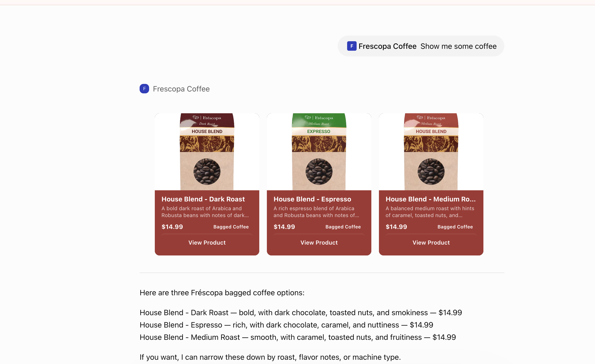

# Testen der LLM-App als [!DNL ChatGPT]-Plug-in {#test-in-chatgpt}

>[!IMPORTANT]
>
>LLM-Apps stehen allen AEM Sites Cloud Service-Kunden zur Entwicklung und Verwaltung eigener Apps zur Verfügung. Sobald die Erfassung beginnt, wird jeder App-Aufruf für die AEM Sites-Inhaltsanfragen des Kunden angerechnet. Adobe gibt die Pipettierungsrate und das Startdatum vor dem Inkrafttreten der Pipettierung an.

Nach der Bereitstellung stellt Ihre LLM-App eine MCP-Server-URL bereit. Fügen Sie diese URL zu [!DNL ChatGPT] als Plug-in hinzu und testen Sie dann die generierten Aktionen und Widgets.

**In diesem Handbuch:** Erfahren Sie, wie Sie Ihre bereitgestellte App mit [!DNL ChatGPT] verbinden und ihre Aktionen und Widgets in einer Konversation testen. Aktualisieren Sie die Verbindung nach dem Ändern der App.

## Plananforderungen

Ein Konto und einen Arbeitsbereich verwenden, die das Hinzufügen benutzerdefinierter MCP-Server zulassen. Die Verfügbarkeit und die Administratorsteuerung variieren je nach Konto und Arbeitsbereich. Siehe die aktuelle Dokumentation [Verbinden und Testen des Plug-ins](https://developers.openai.com/plugins/deploy/connect-chatgpt) von OpenAI.

## Zugriff auf benutzerdefinierte MCP-Server überprüfen

Öffnen Sie [ChatGPT Plugins](https://chatgpt.com/plugins) und überprüfen Sie, ob Ihr Konto das Hinzufügen eines benutzerdefinierten MCP-Servers erlaubt. Wenn für Ihr Konto der Entwicklermodus erforderlich ist, aktivieren Sie diesen Modus mithilfe der Steuerelemente Ihres Kontos. Wenn die benutzerdefinierte MCP-Server-Option fehlt oder blockiert ist, wenden Sie sich an den Workspace-Administrator.

## MCP-Server-URL kopieren

In [!DNL LLM Apps]:

1. Öffnen Sie die App-Detailseite.
2. Suchen Sie **[!UICONTROL App testen]**.
3. Wählen **[!UICONTROL unter „Staging]** die Option **[!UICONTROL URL kopieren]**.

## Erstellen des Plug-ins

1. Öffnen Sie [chatgpt.com/plugins](https://chatgpt.com/plugins).
2. Wählen Sie **+** und dann **[!UICONTROL Benutzerdefinierten MCP-Server hinzufügen]** aus.
3. Konfigurieren Sie die Verbindung:
   - **[!UICONTROL Name]** - der Plug-in-Name.
   - **[!UICONTROL Beschreibung]** — optional.
   - Wählen Sie die Verbindungsmethode für den öffentlichen Server aus und geben Sie die vollständige HTTPS-MCP-Server-URL Ihrer App ein.
   - Wählen Sie die Authentifizierungsmethode aus, die Ihrer App entspricht. Für eine öffentliche App mit deaktivierter Authentifizierung verwenden Sie **[!UICONTROL Keine Authentifizierung]** wo angeboten.

   >[!NOTE]
   >
   >Wenn Sie die Endbenutzerauthentifizierung aktiviert haben, wählen Sie **[!UICONTROL OAuth]** aus, wenn jede Aktion für eine Kombination aus öffentlichen und geschützten Aktionen auf **[!UICONTROL Erforderlich]** oder **[!UICONTROL Gemischt]** eingestellt ist, wobei diese Optionen angeboten werden. Siehe [Endbenutzer bei Ihrem eigenen Identitätsanbieter authentifizieren](/help/guides/authentication.md).

4. Wählen Sie **[!UICONTROL Ich verstehe und möchte fortfahren]**.
5. Wählen Sie **[!UICONTROL Als Plug-in erstellen]** aus.
6. Überprüfen Sie die erkannten Tools und Metadaten und installieren oder verbinden Sie dann das resultierende Plug-in. Vollständige Anmeldung, wenn die App dies erfordert.

OpenAI besitzt die Setup-Benutzeroberfläche. Ihr Layout kann je nach Konto variieren. Folgen Sie den aktuellen [Verbindungsanweisungen](https://developers.openai.com/plugins/deploy/connect-chatgpt), wenn die angezeigten Beschriftungen unterschiedlich sind.

## Testen des Plug-ins

1. Neuen Chat starten.
2. Geben Sie `@` in das Eingabeaufforderungsfeld ein und wählen Sie das installierte Plug-in aus.
3. Stellen Sie eine Frage, die einer der generierten Aktionen entspricht. Beispiel: *Zeig mir Kaffee.*

Überprüfen Sie, ob:

- [!DNL ChatGPT] ruft die erwartete Aktion auf.
- Das Widget zeigt die erwarteten Beispieldaten an.
- Die Textantwort entspricht dem Widget.
- Widget-Steuerelemente funktionieren erwartungsgemäß.

Testen Sie auch ungültige Eingaben, leere Ergebnisse, nicht verwandte Eingabeaufforderungen, die die App nicht aufrufen, und Aktionen, die Daten ändern. Überprüfen Sie jede Bestätigungs- und Authentifizierungs-Eingabeaufforderung, anstatt alle Anforderungen im Voraus zu genehmigen.

### Optionale Erweiterungen testen

Wenn Sie [ChatGPT-Erweiterungen](/help/guides/chatgpt-extensions.md) konfiguriert haben, versuchen Sie jeden ausgewählten Einstiegspunkt, jede Anzeigeeinstellung und die Suche nach dem Composer und vergleichen Sie das Ergebnis mit dem erwarteten Verhalten in diesem Handbuch. Wenn mehrere Einstiegspunkte dasselbe Widget verwenden, testen Sie jede ausgewählte Möglichkeit, es zu öffnen, einschließlich ohne Datei für „Global“ oder „Thread“. Beim Verbinden der App oder Aufrufen einer Aktion in einer Konversation werden diese Funktionen nicht überprüft. Überprüfen Sie [Client-Anforderungen](/help/guides/chatgpt-extensions.md#before-you-begin) zuerst: Für Dateieinstiegspunkte ist ein Desktop erforderlich, und die Web-Unterstützung der OpenAI-Erweiterung schließt das klassische ChatGPT aus.

## Nach Programmänderungen aktualisieren

Nach dem Ändern von Aktionsbeschreibungen, Eingaben, Authentifizierung oder Widget-Konfiguration:

1. Stellen Sie die aktualisierte App in derselben Umgebung bereit.
2. Öffnen Sie die Verbindung über [ChatGPT-Plug](https://chatgpt.com/plugins) und wählen Sie **[!UICONTROL Aktualisieren]** aus.
3. Überprüfen Sie, ob die angekündigten Aktionen geändert wurden.
4. Beginnen Sie eine neue Unterhaltung und wiederholen Sie die betroffenen Tests.

## Wie geht es weiter

- [Anpassen der generierten Widgets](/help/guides/widgets.md).
- [Erstellen einer Aktion von Grund auf](/help/guides/create-action.md).
